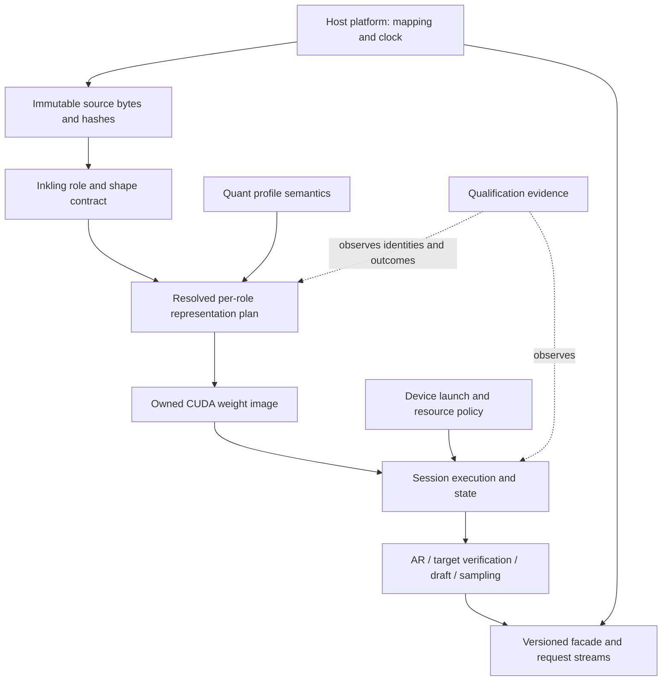

# Architecture first, then numerical consistency

Status: **proposed design for review; not implemented**. Date: 27 November 2026.
Baseline: `5553ef371e2e0342f3ea3dc546b74fcb1e9364dc`.
Companion: [C/architecture/quant/model audit](../audits/c-architecture-quant-model-audit-2026-11-27.md).

## Decision

Establish architectural consistency before attempting numerical repairs across
GB10, GB202 and Ampere. Preserve the specialized Inkling engine, C ABI, model
bytes, precision defaults, allocation order, numerical kernels and serving boundary.
Use small private contracts and behavior tests, rather than a generic model or
backend framework.

There are two separate review gates:

1. **Architecture/evidence gate:** resolve ownership and identity, prove that
   structural changes preserve the existing per-target behavior, and make
   experiments trustworthy. Existing numerical failures stay visible.
2. **Numerical gate:** isolate representation, execution, routing and sampling
   differences; establish an approved agreement contract; only then repair
   numerical paths and measure performance.

No implementation, new GPU run, toolchain change or remote operation is authorized
by this document. Existing measurements are evidence inputs, not new acceptance.

## Starting evidence and its limits

| Target | Recorded configuration | Existing numerical observation |
| --- | --- | --- |
| GB202-class RTX | RTX PRO 6000 Blackwell Max-Q; CC 12.0 / `120a`; Linux AMD64; CUDA 13.5.37 | 28/28 historical profile-specific goldens |
| GB10 | CC 12.1 / `121a`; Linux ARM64; CUDA 13.0.88 | 17/28 historical goldens |
| Ampere | RTX 3090 Ti; CC 8.6 / experimental `86`; Windows AMD64; CUDA 13.3.73 | 11/28 goldens; all five repetitions deterministic per case |

Confirm exact chip/device identity and UUID before future runs. Historical RTX
and GB10 evidence uses `cf211032ed41df4de743576b1284cc929661a43f`; Ampere execution
uses `0d41de5cda1229053bf0627e30936ddb7f94f8d1`. Do not compare these as a controlled
same-revision experiment or infer a silicon cause from their different results.

Ampere already passed small independent conversion oracles, graph replay, packing
memcheck, real facade/recovery and 18 weight/KV format smokes. Its benchmark
prefilled up to 8,844 real tokens; a 32K arena does not establish 32K context
accuracy. Some 96-token benchmark outputs end before final answers. Broad quality,
teacher-forced logit comparison and complete operation coverage remain open.

Jev Bush explicitly defines strict scalar results and tests execution-shape
invariance. Inkleberry has no equivalent canonical full-model CPU path or declared
strict math contract. The mixed `exact` profile retains source quantization and
is **not** a full-precision oracle. bitnet.c's model/quant/backend separation and
behavior maps are useful patterns; its model registry and generic tolerances are
not requirements for this library.

## Architecture contract

### 1. Model anatomy owns the model

A private Inkling contract owns dimensions, required tensor roles and shapes,
physical layers, 48 visits, the repeated middle cycle, local/global attention,
expert-storage split, MTP tap visits and vocabulary boundaries.

First centralize or derive the C-side facts and mechanically assert agreement
with retained CUDA constants and generated bridge layouts. Do not immediately
rewrite pinned CUDA files or introduce runtime shape polymorphism. Role and visit
identity must be stable enough to name intermediate traces unambiguously.

Model admission must remain strict: exact names/dtypes/shapes, optional MTP with
no silent fallback, excluded vision tensors, immutable borrowed inputs. A model
variant that fails this contract remains unsupported.

### 2. Quant semantics own representation choices

Separate three concepts currently expressed partly by numeric kinds:

| Concept | Example | Owner |
| --- | --- | --- |
| Source storage | BF16 dense tensor; packed source NVFP4 expert; MXFP8 expert | Admitted role/schema |
| Loaded representation | BF16 matrix; FP8 row scales; FP4 block/global/expert scales; fused MTP matrix | Resolved quant/layout plan |
| Arithmetic execution | FP16/BF16 products, F32 accumulation, GEMV/MMA/cuBLAS path, KV conversion | Backend operation and numerical policy |

A private resolved plan should describe, for each role/view: dimensions, source
role, encoding, block geometry, scale encoding/axis, transform version, destination
layout and allocation extents. It should also make clear which KV/rings remain
BF16 when a user selects FP8/Q4 for the eligible global caches.

Initially resolve exactly the current profiles. Preserve public enum values,
profile spellings and default precision. Replace positional string-table arithmetic
with named private descriptors only after parity tests exist. No generic plugin
registry or new checkpoint format is needed.

### 3. Backend layout owns device representations

Checkpoint/tokenizer metadata remains host-side. `ifn_gpu_weights` owns device
arenas, packed/scaled tensors and their lifetime. Its immutable loaded views may
be borrowed by a session; the session must not become another owner of them.
Session resources own KV, activations, rings, graph handles, cuBLAS and workspaces.

Keep the existing private upload/fault-injection seam. It does not imply that
execution is backend-neutral. Do not add a whole-engine vtable until a second
execution backend actually exists. Do not move CUDA handles onto source tensor
metadata to imitate a shared model object.

### 4. Device policy separates independent facts

| Fact | Required treatment |
| --- | --- |
| Compiled image target | Explicit 120a / 121a / experimental 86; exact admission |
| Launch ordering | PDL versus ordered stream launch; does not select quant semantics |
| Kernel resources | Checked per current owner context, before capture/execution where required |
| Arithmetic behavior | Recorded conversion, accumulation, reduction and vendor choices |
| Qualification | External evidence for a specific source/build/device/configuration; not inferred from support flags |

Remove resource-policy dependence on a boolean whose actual meaning is PDL.
Preserve Blackwell's valid execution behavior in structural work. Extending checked
resource preparation/error propagation to its legacy path is a separately tested
correctness change, not a cosmetic refactor.

Keep process-wide one-session admission while legacy shared native helpers remain.
Do not add concurrency, scheduling, Keel serving, multi-GPU execution or background
workers during this story.

### 5. Facade and lifecycle remain stable

Keep version negotiation, initialized outputs, borrowed callback records, copied
request input, explicit budgets, cancellation seal and retained cleanup unchanged.
The low-level partial-create cleanup handle and the facade's create/prepare split
are intentionally different contracts; preserve both.

Do not promote compiled-feature flags into numerical certification. Start with a
private diagnostic manifest. A future public capability extension is justified
only by a concrete consumer, with its own version/ABI review.

Prefix state remains session-local and scope-isolated. Current immutable model and
session configuration already bind its meaning. A shared or serialized cache is
not proposed; if added later, it would also need model/representation/math identity.

## Gate A: architecture and evidence consistency

### Proposed sequence

| Step | Deliverable | Required evidence before continuing |
| --- | --- | --- |
| A0 | Fixed baseline and behavior map | Exact source/input/binary identity; inventory current failures; preserve goldens |
| A1 | Private model contract | C/CUDA dimensions, roles, expert split, vocabulary and schedule agree mechanically |
| A2 | Resolved quant/layout descriptors | Every old profile resolves to identical views, offsets, bytes, scales and transform order |
| A3 | Separate launch/resource policy | Host policy matrix; context/lifetime failures; no silent graph/precision fallback |
| A4 | Trustworthy qualification receipts | Real toolchain/paths, source verification, per-run workload identity, fail-closed incomplete data |

One coherent change per review. Do not combine an architectural move with a new
kernel, changed quantization, altered sampling or a performance optimization.

Existing exact allocation/fault/ABI/package tests should be extended, not replaced.
Add architectural checks for permitted dependencies and authoritative metadata;
avoid tests that merely grep a preferred spelling.

### Architecture acceptance tests to design next

- Preserve all source-role shapes, source order, excluded vision roles and MTP
  rejection cases; mutate one dimension/role/scale encoding at a time.
- Assert the 48 visit tuples, attention kinds, tap visits and local/global cache
  geometry independently of the code producing them.
- For all six weight/MTP profiles and six execution profiles, compare resolved
  plan identities and exact arena/view extents to the pre-change contract.
- Verify local cache representation separately from selected global KV format.
- Exercise every upload/prepare/finalize failure boundary with retained resource
  ownership, context restoration, first-error diagnostics and safe retry/close.
- Preserve C/CUDA records, static/shared/amalgamated consumers, Windows compilers
  and source/runtime package behavior.
- Preserve request isolation, callback boundaries, cache scope and cancellation.
- Reject a receipt with the wrong source digest, claimed Git revision, target,
  compiler identity, model hash, prompt tokens, repetition config or missing stage.
- Verify build profile and runtime qualification stay separate.

For structural parity, capture observations on the *same target/configuration*
before and after. Per-device observations that already fail a global golden may
be used to detect a new structural regression, but are not new approved goldens
and do not turn the numerical gate green.

## Gate B: numerical consistency contract

### Three levels of agreement

| Level | Proposed requirement |
| --- | --- |
| Semantic/representation | Same admitted bytes and role mapping; exact scale/layout interpretation; defined RNG, ties, masking, state and acceptance rules |
| Fixed-plan repeatability | Identical outcomes across repetitions of the same executable, packed image, device and execution plan, where claimed |
| Cross-target arithmetic | Per-operation bounded error and defined decision behavior on a fixed teacher-forced token stream; separately measured semantic and distribution quality |

Cross-device bit-identical free-running tokens are a stronger, separate product
requirement. They are not implied by repeatability, low-level conversion equality
or the current use of CUDA. Before numerical implementation, review whether a
slower canonical strict path is required, or whether bounded arithmetic with
explicit decision-boundary handling is the accepted contract.

Do not relax a failing golden or describe near ties as harmless without locating
the first difference. A strict reference path may be explored in a diagnostic
build; it must not silently replace the production fast path.

NVIDIA's documented cuBLAS reproducibility conditions are narrower than this
three-device matrix. Host library math, toolkit versions, algorithms, FMA,
reductions and fast-math settings must be controlled or recorded. See the primary
references below; none of those facts establishes the cause of today's divergence.

### Experiment order: locate the first difference

1. **Freeze inputs and resolved plan.** Same source commit, tokenizer/template,
   token IDs, tensor bytes/hashes, quant settings, KV format, schedules, limits,
   sampling parameters and graph policy. Text equality alone is insufficient.
2. **Compare representation before forward execution.** Compare source-role
   mapping, loaded view extents, all packed bytes/scales and host-derived MTP
   coefficients. `weights_recipe.c:280` computes fusion coefficients using host
   double `exp`; conversion/scale work also occurs during device upload. Identical
   source weights therefore do not by themselves prove identical loaded images.
3. **Isolate packing from execution.** If native packing differs, a diagnostic
   frozen packed image can be fed to each target to distinguish upload from
   forward arithmetic. This is a private test artifact with a manifest, not a
   new production format. Serialize view bytes/scale metadata, never pointers
   or opaque backend handles. Layout incompatibility must fail explicitly.
4. **Teacher-force short AR.** Feed identical valid token IDs independent of
   generated decisions; disable speculation/cache reuse for the first probe.
   Existing `ifn_session_logits` supports 1..8 inputs and final-position logits.
   Start with that, including singleton versus batched tails, without an ABI change.
5. **Compare prefill and execution shapes.** The existing public logits operation
   cannot expose the whole batched-prefill path. Design a private test observer or
   prefill-then-probe helper around existing execution, not a second model engine.
   Replay equal prefixes with batch/chunk boundaries around 1, 2, 4, 8, 32, 128,
   256, 1024 and 2048, including tails and local-window boundaries.
6. **Find the earliest stage divergence.** Trace selected visits and operators
   progressively rather than dumping the whole model on every token. Check
   embedding/norm, Q/K/V, positional/relative attention, softmax, context combine,
   residual/controller paths, router logits/IDs/weights, expert outputs, final norm
   and LM head. Record physical layer *and visit/pass*, since layers are reused.
7. **Add MTP/verification.** Compare target single-token versus verification batch
   with identical teacher-forced prefixes, then draft probabilities, acceptance,
   residual sampling, lookup Dirac proposals and state commit. A fixed-width or
   adaptive controller may change work, not the declared target semantics.
   Specifically probe NVFP4 singleton FP16 partial sums against batched FP32 MMA
   accumulation (`cuda/kernels_gemv.cu:234`, `:332`, `:1156`). Establish their
   numerical relationship before treating batched verification as equivalent to
   singleton target execution; this source difference is not a diagnosed cause.
8. **Add state reuse and lifecycle.** Repeat through eager/graph, cold/warm prefix,
   changed scopes, cancellation/recovery and the public facade. Compare complete
   state progression, not just final text on one short arithmetic prompt.
9. **Free-running quality and performance last.** Once the arithmetic cause is
   classified, evaluate completed answers and measure equivalent workloads. Keep
   old artifacts and compare identical outputs where reporting strict speedups.

### Independent references

Reuse the existing independent FP4/FP8 decoder equations and sampling diagnostics.
Extend with small test-only scalar C/high-precision references for the operations
that lack them: quantization encoding rounding/saturation and scale selection,
scaled dot products/GEMM, normalization, softmax, attention, MoE
routing/combination and controller transforms. Model actual intermediate rounding
when testing a specific kernel; a higher-precision mathematical answer is a
separate accuracy reference, not the same computation by definition.

Do not rebuild a production CPU inference backend or restore the deleted Zig
implementation. A pinned external reference supporting the exact Inkling model
could supply additional full-model evidence, but is test-only and must demonstrate
its own model/quant equivalence. Do not compare different model or quant weights
as if they were the same reference.

### Error and decision policy

- Encodings, dimensions, layouts, scale axes, masks, integer state transitions and
  specified tie rules require exact agreement.
- FP4/FP8 decode tests compare exact finite values and signed zero; NaN treatment
  follows a declared classification/payload policy rather than assuming portable
  NaN bit patterns.
- For floating outputs, pre-register operation-specific absolute/relative budgets,
  ULP diagnostics where meaningful, and error growth expectations for the actual
  dtypes/reduction lengths. Do not copy bitnet.c's fixed `max_diff < 2.0` or fit
  one universal tolerance to the observed failures.
- A useful tensor criterion is
  `abs(candidate-reference) <= atol_op + rtol_op * max_abs(reference)`;
  also inspect RMS/scaled error, non-finites and the worst offending indices.
  Numerical tolerances are a review decision, not finalized numbers in this design.
- If a full logit error bound is epsilon and the reference top-two gap exceeds
  `2*epsilon`, greedy top-1 disagreement is a failure. A smaller gap is an
  explicitly reported ambiguous decision, not an automatic pass. It remains a
  failure if exact token portability is the selected product requirement.
- Treat MoE routing discontinuities similarly. Distinguish arithmetic error from
  an incorrect tie policy or state bug before accepting different expert IDs.
- Seeded sampling equality and distribution preservation are separate properties.
  Extend independent analytic fixtures to target/proposal/residual edge cases,
  tiny probabilities, support mismatches and lookup proposals. Pre-register sample
  counts, effect sizes and confidence tests; matching one seeded sequence is not
  proof of exact sampling correctness.

## Trace/evidence format to review

A proposed private manifest would bind:

| Identity class | Required data |
| --- | --- |
| Source/build | Git SHA plus verified content manifest; generated ABI and retained-source hashes; compiler/NVCC/link flags; binary hashes |
| Model/representation | Model/tokenizer/MTP hashes, role-contract and recipe versions, packed view hashes and scales/coefficient hashes |
| Platform/device | OS/CPU architecture, actual loaded CUDA/cuBLAS/driver identities, device UUID/CC/SM count, compiled target |
| Execution | Weight/KV profiles, graph/eager policy, kernel/algorithm choices when observable, reduction/fast-math policy and workspace sizes |
| Request | Exact prompt IDs/hash, template/history settings, seed and sampling parameters, maximum output, prefix/cache scope, forcing sequence |
| Observation | Probe schema, stage/visit/pass/position, dtype/shape/strides/scale axes, bounds/status, comparison budgets and outcome |

Avoid asserting vendor algorithm IDs that are not exposed by the selected API;
record that limitation or use a separately approved diagnostic path. No secrets,
model payloads or private prompts belong in checked-in reports. Detailed tensor
captures stay external with hashes and bounded retention. Evidence publishing
must atomically invalidate old success on a new failed/incomplete attempt.

Observer design constraints:

- private/test-only; no function-table or public record layout changes initially;
- default execution has no additional allocation, synchronization or host callback;
- bounded, preallocated capture buffers with explicit borrowed/owned lifetimes;
- no host observer invoked inside CUDA graph capture;
- instrument eager diagnostic execution first, then validate graph snapshots or
  replay after safe completion without changing the default graph;
- instrumented and uninstrumented outputs must agree before trusting a trace;
- failures/cancellation cannot publish partial captures as successful evidence.

## Controlled device matrix

Start with GB202, then GB10, then Ampere using one reviewed source revision and
verified model/representation. The order is investigative, not an assumption that
one GPU defines mathematical truth. Include both eager and graph AR before
speculation and state reuse.

Where already available and driver-compatible, use a common toolkit and comparable
host compiler settings. The historical toolkit versions differ; do not upgrade
hosts/drivers or inference services just to force a match. If a matched toolchain
is unavailable, report the OS/compiler/library confound and use controlled
packed-image and operation probes to narrow it. Any new environment provisioning
needs its own authorized scope.

Add a second host-compiler run on AMD64 where supported to separate compiler from
GPU effects; preserve native ARM64 GB10 and native Windows Ampere coverage. A
Windows success does not qualify Linux Ampere. Do not present one mixed OS/CPU/
toolkit comparison as a clean GPU-only A/B test.

## CI, regression and release rules

| Gate | CPU CI | Explicit reserved-device campaign |
| --- | --- | --- |
| ABI, ownership, parser/fault behavior | Existing plus contract regressions | Native layout/context/cleanup probes |
| Model/quant consistency | Role/profile/plan matrices, independent scalar fixtures | Actual packing and scaled-operation agreement |
| Evidence validity | Reject mixed prompts/configs, stale source, forged target and incomplete records | Match actual loaded device/library/binary identities |
| State and numerics | Deterministic analytic references | Teacher forcing, stage traces, eager/graph and AR/verification comparisons |
| Product quality | Score definitions and fixture validation | Completed code/JSON/retrieval answers and sampling distributions |
| Performance | Gate logic tests | Same-target before/after; equivalent prompts, precision, outputs and budgets |

Retain mandatory Linux host CI and Windows compiler checks. GPU campaigns remain
explicit and reserved, with current guard behavior; no self-hosted automatic
execution of untrusted PRs. Reuse `tools/run_model_release.py` after repairing its
identity/platform assumptions; do not introduce a second release build system.

Performance thresholds apply to a same-target/configuration regression campaign,
not to cross-device comparisons. Preserve existing performance gates unless a
specific reviewed change warrants another contract. Trace overhead is measured
separately and cannot be hidden in a normal inference performance claim.

Do not regenerate global goldens to make a platform pass. Keep failed receipts,
first-divergence evidence and partial qualification states. Temporary diagnostic
builds do not become default production math by accident.

## Review decisions before implementation

1. Approve the minimal private model/quant/identity ownership boundaries; retain
   the CUDA-only, single-model and one-session process scope.
2. Decide whether cross-device bit-identical tokens are mandatory or whether the
   bounded-arithmetic/decision/distribution contract above is the intended default.
3. Approve per-operation budgets and the independent-reference set before running
   a numerical repair campaign; current failure data must not dictate tolerances.
4. Keep architecture-only changes separate from resource/error correctness fixes,
   diagnostic instrumentation, numerical repairs and performance work.

Completion of Gate A means the architecture and evidence are consistent, not that
GB10 or Ampere's known numerical gate has passed. Completion of Gate B requires
an explicit review of the actual deviations, quality outcomes and performance.

## Primary numerical references

- [NVIDIA cuBLAS reproducibility](https://docs.nvidia.com/cuda/cublas/index.html#results-reproducibility): its stated bitwise repeatability conditions do not establish equality across these architectures and toolkit versions.
- [NVIDIA floating-point guide](https://docs.nvidia.com/cuda/floating-point/index.html): operation ordering, FMA and rounding choices matter when comparing heterogeneous execution.
- [NVCC fast-math option](https://docs.nvidia.com/cuda/cuda-compiler-driver-nvcc/index.html#use-fast-math-use-fast-math): record the effective floating-point options rather than treating the current build as a declared strict numerical reference.

These references inform the experiment design; they do not diagnose the current
17 Ampere or 11 GB10 sequence differences.
